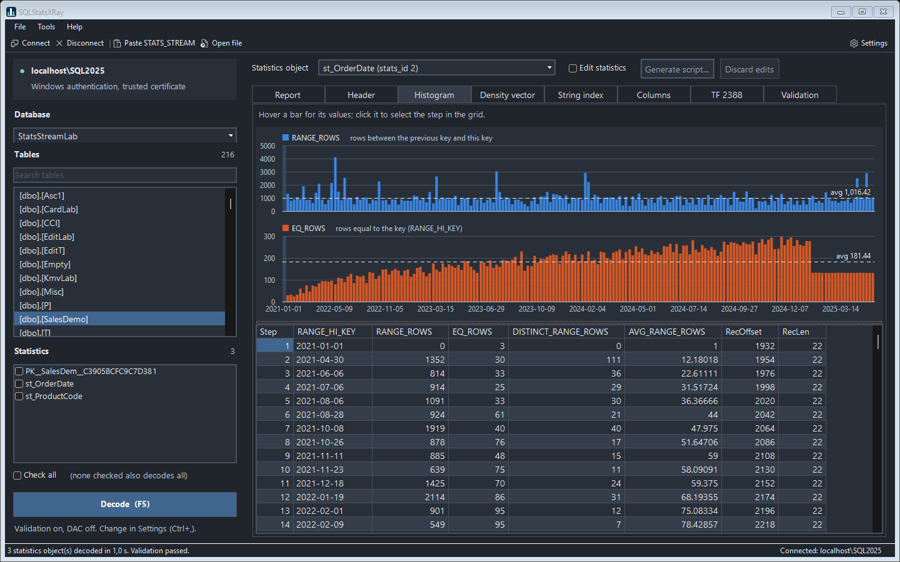
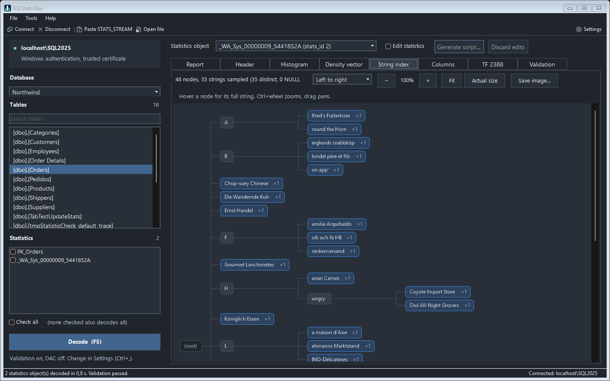

<p align="center"></p>

# SQLStatsXRay

SQLStatsXRay decodes SQL Server statistics completely: the undocumented binary that `DBCC SHOW_STATISTICS ... WITH STATS_STREAM` returns, byte by byte. It shows everything SQL Server keeps for a statistics object, including the parts DBCC never shows, and lets you edit the statistics and generate the `UPDATE STATISTICS ... WITH STATS_STREAM` script that loads them back.

It comes in three forms:

| | What it is |
|---|---|
| **SQLStatsXRay app** | A Windows app (dark or light theme) to browse a server's statistics, decode a pasted stream, view and edit the result |
| **`Decode-StatsStream.ps1`** | The same decoder as a PowerShell command, for reports, automation and `-PassThru` objects |
| **`usp_DecodeStatsStream`** | A T-SQL port: decode from a query window, or collect a whole instance into tables |



## What it decodes

- **Stream header:** version, column count, lengths and the checksum, recomputed and verified.
- **Column definitions:** type, length, precision, scale, nullability, collation and code page.
- **Blob header:** updated date, rows, rows sampled, steps, vector count, average key length, NULL step.
- **Histogram:** every step, including the NULL step, with each key decoded for its type (numeric, date and time, character in the collation's code page, UTF-8, binary, uniqueidentifier, sql_variant, hierarchyid). Each step also shows its byte offset and the raw record.
- **Density vector:** every vector, including those past 33 (statistics on a nonclustered index also include the clustering keys).
- **Update history:** the previous updates that trace flag 2388 shows. The app rebuilds the full TF 2388 result, including the *Leading column Type* (Ascending / Descending / Stationary / Unknown) that drives the ascending key behavior.
- **String index:** the trie SQL Server keeps for `LIKE` estimates on string columns, drawn as a tree.
- **Distinct value synopsis:** the hash sketch kept by sampled updates, with the distinct-count estimate it gives.
- **Other items:** unfiltered rows (filtered statistics), pages sampled, persisted sample percent, columnstore page counts and streaming statistics flags.
- **Layout map and hex dump:** every field with its offset, so nothing in the stream goes unexplained.

`-Validate` (or `@Validate = 1`) compares every decoded value with what SQL Server reports through `DBCC SHOW_STATISTICS`, `sys.dm_db_stats_histogram` and trace flag 2388.

## Checking histograms against the data

`-VerifyData` (the app's **Data check** tab, F6) compares each histogram with the rows actually in the table:

- **One seek per step.** It reads through a rowstore index whose first key column is the statistics' leading column (the smallest one), so column statistics are checked too. Each step's range gives the real EQ_ROWS, RANGE_ROWS and DISTINCT_RANGE_ROWS, plus the largest row count for a single value inside the step. Two more seeks count the NULL rows and the rows above the last step (the ascending key problem).
- **Low impact.** READ UNCOMMITTED, `LOCK_TIMEOUT 1000`, `MAXDOP 1`, a query timeout, an optional pause between steps, and a page budget (default 100,000 pages, about 780 MB). On a larger index it becomes a spot check: the NULL rows, both ends of the histogram, then steps at random while they fit.
- **No side effects on the statistics.** The queries use `OPTION (KEEPFIXED PLAN)`, which keeps them from triggering an automatic update of a stale statistic they read.
- **Typed comparisons.** Each step key is bound as a parameter of the column's own type, and `varchar` keys are converted in the column's collation, so case-insensitive, trailing-space and code-page rules match the histogram's.
- **Results you can act on.** Every range is rated by q-error (how many times the estimate is off, either way): Exact, Good (up to 2), Fair (up to 10) or Poor. The findings separate sampling error from modifications since the update, flag steps that hide a frequent value, and suggest a higher sample rate or `PERSIST_SAMPLE_PERCENT` when sampling is the cause. FULLSCAN statistics with no modifications must match exactly; when they don't, the statistics were probably loaded with `STATS_STREAM`.

It skips filtered, incremental and columnstore statistics, indexed views, memory-optimized tables, and statistics with no supporting index. It needs `SELECT` on the table. The results show step numbers and counts, not key values.

```powershell
.\Decode-StatsStream.ps1 -ServerInstance "localhost" -Database DB1 -Table dbo.Orders -Statistics IX_Orders_OrderDate -VerifyData -VerifyPageBudget 20000
```

The binary layout is documented in [STATS_STREAM-format.md](STATS_STREAM-format.md).

## Requirements

- Windows PowerShell 5.1 or PowerShell 7. The app needs Windows.
- SQL Server 2017 or later for the T-SQL procedure (`STRING_AGG`, `CREATE OR ALTER`). The PowerShell decoder has no such limit.
- The permissions of `DBCC SHOW_STATISTICS` on the tables you decode. `-UseDac` needs sysadmin and the Dedicated Admin Connection. `-VerifyData` needs `SELECT` on the table. Running a generated `UPDATE STATISTICS ... WITH STATS_STREAM` script needs `ALTER` on the table.

Developed and validated on SQL Server 2025 and SQL Server 2022.

## Getting started

### The app

Double-click `SQLStatsXRay.cmd`, or run:

```powershell
.\Decode-StatsStream.ps1
```

- **File > Connect...** to a server, then pick a database, filter the table list and choose a statistic. Browsing stays disabled until you connect.
- **File > Paste STATS_STREAM...** decodes a stream copied from SSMS (the whole DBCC row or just the `0x...` value), with no server needed. **File > Open STATS_STREAM file...** does the same from a file.
- Tabs: Report, Header, Histogram (with a chart), Density vector, String index (tree view, left to right or top down), Columns, TF 2388, Validation and Data check.
- **Check against the table (F6)** on the Data check tab compares the selected statistics object's histogram with the table data (see [Checking histograms against the data](#checking-histograms-against-the-data)). It runs only when you ask, one statistics object at a time.
- **Edit statistics** turns on editing of the header, histogram steps (insert and delete with a right click) and density vector. **Generate script...** builds the edited stream with a new checksum and writes the `UPDATE STATISTICS ... WITH STATS_STREAM` script, optionally with `NORECOMPUTE` and a commented block that restores the original statistics. The app never runs the script itself.
- **Tools > Settings...** holds the theme, connection defaults and report limits. They are saved per user in `%LOCALAPPDATA%\SQLStatsXRay\settings.json`. Passwords are never saved.



### PowerShell

```powershell
# Report for every statistic of a table
.\Decode-StatsStream.ps1 -ServerInstance "localhost" -Database AdventureWorks -Table Sales.SalesOrderDetail

# One statistic, compared with DBCC, saved to a file
.\Decode-StatsStream.ps1 -ServerInstance "localhost" -Database DB1 -Table dbo.T -Statistics IX_T_Col -Validate -OutputFile .\T_stats.txt

# Decode a saved stream, no server needed
.\Decode-StatsStream.ps1 -InputFile .\stream.txt -ColumnNames OrderDate

# Objects instead of text
$s = .\Decode-StatsStream.ps1 -ServerInstance "localhost" -Database DB1 -Table dbo.T -Statistics s1 -PassThru
$s.Histogram | Format-Table
```

`Get-Help .\Decode-StatsStream.ps1 -Full` lists every parameter (`-UseDac`, `-IncludeHexDump`, `-FullPrecision`, `-Credential`, `-ConnectionString`, ...).

### T-SQL

Create the procedure from `usp_DecodeStatsStream.sql` in any database, then:

```sql
-- One statistic, as result sets
EXEC dbo.usp_DecodeStatsStream @DatabaseName = N'AdventureWorks', @TableName = N'Sales.SalesOrderDetail',
     @StatsName = N'IX_SalesOrderDetail_ProductID';

-- A table, checked against DBCC
EXEC dbo.usp_DecodeStatsStream @DatabaseName = N'Northwind', @TableName = N'dbo.Orders', @Validate = 1;

-- A whole database into tempdb.dbo.StatsStream_<Section> tables
EXEC dbo.usp_DecodeStatsStream @DatabaseName = N'Northwind', @OutputDatabase = N'tempdb', @ProgressSeconds = 10;
```

`Collect-StatsStream.sql` runs the procedure over every database of the instance and stores each section in its own table (`StatsStream_Histogram`, `StatsStream_DensityVector`, ...). All the tables share the same five leading columns, so they can be joined. Statistics are read one at a time, under `READ UNCOMMITTED` with a 100 ms lock timeout. Anything blocked is skipped and logged, so the collection never blocks the workload.

## Handle the output as customer data

Statistics carry real values from your tables: every histogram step is a value taken from the column, and the string index holds pieces of the strings. Treat reports, saved streams and the collection tables as data from that database. The data check leaves key values out, but its counts still describe the customer's data. Be careful where you paste or store them, and don't copy them out of a customer environment.

## Editing statistics

`STATS_STREAM` is undocumented and unsupported by Microsoft. Loading an edited stream changes the estimates, and so the plans, of every query that uses the statistic. Use it to reproduce and study plan behavior on test copies, not to tune production. The next automatic or manual statistics update replaces the edited stream, unless `NORECOMPUTE` is set.

## How it was built

The format was reverse engineered from `DBCC SHOW_STATISTICS ... WITH STATS_STREAM`. Every decoded value was checked against DBCC and trace flag 2388 on thousands of statistics. The layout was then confirmed against the SQL Server 2025 engine, using Microsoft's public symbols. See [STATS_STREAM-format.md](STATS_STREAM-format.md) for the details.

It builds on the work of Joe Chang and André Renato Furtado, listed under [References](#references).

## References

- Joe Chang, [Decoding Stats Stream](https://qdpma.azurewebsites.net/CBO/StatStream.html)
- André Renato Furtado, [Understanding SQL Server STATS_STREAM: A Deep Dive](https://www.linkedin.com/pulse/understanding-sql-server-statsstream-deep-dive-andr%25C3%25A9-renato-furtado-63o3f/)

## Author

Fabiano Amorim | [@mcflyamorim](https://github.com/mcflyamorim)

## License

[MIT](LICENSE)
