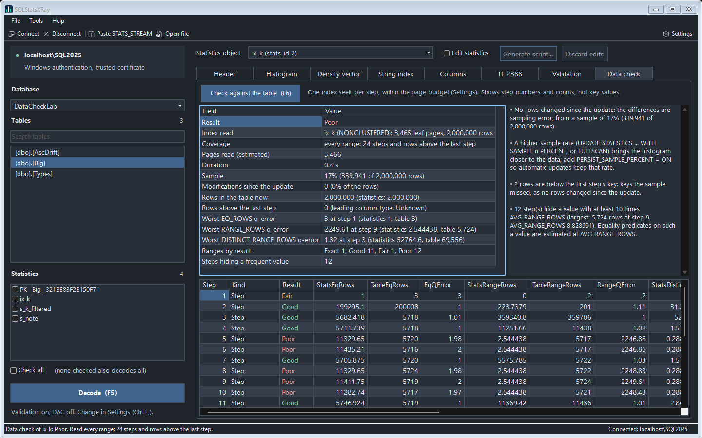
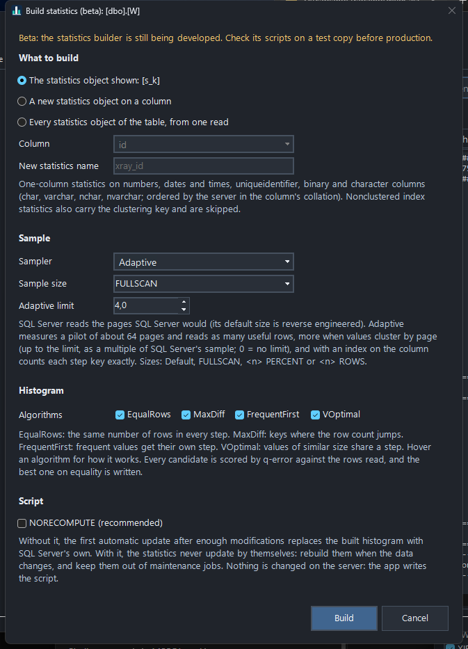
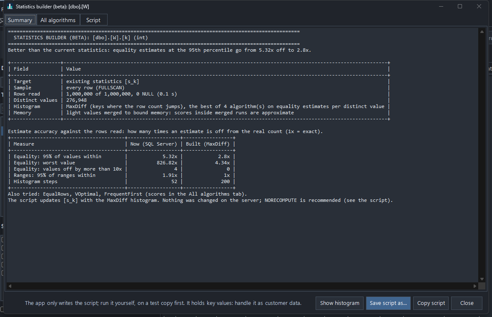

<p align="center"></p>

# SQLStatsXRay

SQLStatsXRay decodes SQL Server statistics completely: the undocumented binary that `DBCC SHOW_STATISTICS ... WITH STATS_STREAM` returns, byte by byte. It shows everything SQL Server keeps for a statistics object, including the parts DBCC never shows, and lets you edit the statistics and generate the `UPDATE STATISTICS ... WITH STATS_STREAM` script that loads them back.

It comes in three forms:

| | What it is |
|---|---|
| **SQLStatsXRay app** | A Windows app (dark or light theme) to browse a server's statistics, decode a pasted stream, view and edit the result |
| **`Decode-StatsStream.ps1`** | The same decoder as a PowerShell command, for reports, automation and `-PassThru` objects |
| **`usp_DecodeStatsStream`** | A T-SQL port: decode from a query window, or collect a whole instance into tables |


## What it decodes

- **Stream header:** version, column count, lengths and the checksum, recomputed and verified.
- **Column definitions:** type, length, precision, scale, nullability, collation and code page.
- **Blob header:** updated date, rows, rows sampled, steps, vector count, average key length, NULL step.
- **Histogram:** every step, including the NULL step, with each key decoded for its type (numeric, date and time, character in the collation's code page, UTF-8, binary, uniqueidentifier, sql_variant, hierarchyid). Each step also shows its byte offset and the raw record.
- **Density vector:** every vector, including those past 33 (statistics on a nonclustered index also include the clustering keys).
- **Update history:** the previous updates that trace flag 2388 shows. The app rebuilds the full TF 2388 result, including the *Leading column Type* (Ascending / Descending / Stationary / Unknown) that drives the ascending key behavior, charts it, and explains it in words (how the table grew, how much changed before each update, where the new rows landed).
- **String index:** the trie SQL Server keeps for `LIKE` estimates on string columns, drawn as a tree.
- **Distinct value synopsis:** the hash sketch kept by sampled updates, with the distinct-count estimate it gives.
- **Other items:** unfiltered rows (filtered statistics), pages sampled, persisted sample percent, columnstore page counts and streaming statistics flags.
- **Layout map and hex dump:** every field with its offset, so nothing in the stream goes unexplained.

From the stream alone, with no further query to the server, the report and the app also work out:

- **Health check.** Problems visible in the statistic itself, rated Good, Fair or Poor:
  - a sample too small for the column's distinct values;
  - step counts with wide 95% intervals (from the rows sampled);
  - few steps for many values;
  - steps whose values average far more rows than the keys around them, which suggests a frequent value hidden in a range;
  - one step covering a large share of the table;
  - a large NULL share;
  - the age of the statistic and an ascending leading column.
- **Estimates.** What an equality on each key estimates (EQ_ROWS) and on a value inside a step (AVG_RANGE_ROWS), against the estimate for an unknown value (all density × rows: local variables, `OPTIMIZE FOR UNKNOWN`). Keys 10× or more away from it are where one plan does not suit every value (parameter sensitivity). The density vector also gives the `GROUP BY` / `DISTINCT` estimate for every leading column combination.
- **Update rhythm and forecast.** How often the statistic updates, and how much changed before each update against the automatic update threshold. At the past change rate, it forecasts how many rows sit past the last step by a date (`-ForecastDate`, now by default) and when the next automatic update is due.

`-Validate` (or `@Validate = 1`) compares every decoded value with what SQL Server reports through `DBCC SHOW_STATISTICS`, `sys.dm_db_stats_histogram` and trace flag 2388.

## Checking histograms against the data

`-VerifyData` (the app's **Data check** tab, F6) compares each histogram with the rows actually in the table:



- **One seek per step.** It reads through a rowstore index whose first key column is the statistics' leading column (the smallest one), so column statistics are checked too. Each step's range gives the real EQ_ROWS, RANGE_ROWS and DISTINCT_RANGE_ROWS, plus the largest row count for a single value inside the step. Two more seeks count the NULL rows and the rows above the last step (the ascending key problem).
- **Low impact.** READ UNCOMMITTED, `LOCK_TIMEOUT 1000`, `MAXDOP 1`, a query timeout, an optional pause between steps, and a page budget (default 100,000 pages, about 780 MB). On a larger index it becomes a spot check: the NULL rows, both ends of the histogram, then steps at random while they fit.
- **No side effects on the statistics.** The queries use `OPTION (KEEPFIXED PLAN)`, which keeps them from triggering an automatic update of a stale statistic they read.
- **Typed comparisons.** Each step key is bound as a parameter of the column's own type, and `varchar` keys are converted in the column's collation, so case-insensitive, trailing-space and code-page rules match the histogram's.
- **Clones and emptied tables.** In a statistics-only clone (`DBCC CLONEDATABASE`) the tables hold no rows, so the check skips them and says why. A table emptied or reloaded without counting modifications (`TRUNCATE TABLE`, a partition `SWITCH`) is reported as such, not as a loaded stream.
- **Results you can act on.** Every range is rated by q-error (how many times the estimate is off, either way): Exact, Good (up to 2), Fair (up to 10) or Poor. The findings separate sampling error from modifications since the update, flag steps that hide a frequent value, and suggest a higher sample rate or `PERSIST_SAMPLE_PERCENT` when sampling is the cause. FULLSCAN statistics with no modifications must match exactly; when they don't, the statistics were probably loaded with `STATS_STREAM`.

It skips filtered, incremental and columnstore statistics, indexed views, memory-optimized tables, and statistics with no supporting index. It needs `SELECT` on the table. The results show step numbers and counts, not key values.

```powershell
.\Decode-StatsStream.ps1 -ServerInstance "localhost" -Database DB1 -Table dbo.Orders -Statistics IX_Orders_OrderDate -VerifyData -VerifyPageBudget 20000
```

## Statistics builder (beta)

> **Beta.** The builder is still being developed. Check the scripts it writes on a test copy before you use them anywhere that matters.

`-Build` (the app's **Tools > Build statistics (beta)...**, Ctrl+B) builds a histogram of its own for a column from the table data, compares it with the statistics SQL Server has, and writes the script that loads it. It never changes the server: you run the script.



- **Two samplers.** *SQL Server* reads the pages SQL Server would: its default sample size was reverse engineered from the engine (`pages x 15 x rows^0.55 / rows + 1,024`, the whole table under 8 MB) and matched SQL Server's own sampled page counts. *Adaptive* first reads a pilot of about 64 pages to measure rows per page and how much the column's values cluster by page, then reads as many *useful* rows as SQL Server's sample would hold (up to 4 times its pages by default). With an index on the column it also counts each step key and the true minimum and maximum exactly. Both take `Default`, `FULLSCAN`, `<n> PERCENT` or `<n> ROWS`.
- **Distinct values counted by page.** Values repeat within pages, so the distinct-value estimate counts each value's pages, not its rows. On a table whose values cluster by page, SQL Server's sampled statistic estimated 4,864 distinct values (true 40,001); the same pages gave 37,503 here.
- **Four histogram algorithms**, all using every one of the 200 steps (SQL Server often stops well short). They are described [below](#how-the-algorithms-differ).
- **Scored before they are written.** Every candidate and the current statistics get a q-error score for every distinct value and 1,000 random ranges, using the estimation rules measured on SQL Server 2025; the best one is written.
- **A verdict, not a wall of numbers.** The report opens with one sentence: better than the current statistics, about the same, or not better (then loading it is not recommended). It names any measure that gets worse. Below it, only the chosen histogram is shown next to SQL Server's current statistics, in plain terms: "95% of values within 1.45x of the real count". `-ShowCandidates` (the app's **All algorithms** tab) lists every algorithm tried with all its scores.
- **Strings too.** `char`, `varchar`, `nchar` and `nvarchar` keys are ordered and compared by the server in the column's collation. The string index SQL Server keeps for `LIKE` estimates is rebuilt from the same rows the way SQL Server builds it: on full scans of six test tables (binary, case-insensitive and SQL collations, long strings) it came out byte for byte identical to SQL Server's, and `LIKE` estimates matched. UTF-8 collations and double-byte code pages (Japanese, Chinese, Korean) get the histogram without a string index, so `LIKE` falls back to SQL Server's guesses.
- **A whole table from one read.** With `-AllStatistics` (or "Every statistics object of the table" in the app), a sample is read once and serves every statistics object on the table; SQL Server samples the table again for each one.



Against the whole table, in the lab: on a column whose values cluster by page, equality estimates were off by 8.93x at the 95th percentile with SQL Server's statistic, 3.85x with a build from the same pages, and 1.11x with the adaptive sampler. A full-scan build of 20 million rows took 4.2 s, as long as SQL Server's parallel `FULLSCAN` (and 5 times less than SQL Server on one core); a sampled build takes under a second.

Limits of this version: statistics on one column of numbers, dates and times, strings, `uniqueidentifier` or binary data, on tables. Nonclustered index statistics carry the clustering key and are skipped. Scores of a sampled build are measured against the sample; score the loaded statistics with a full scan for a verdict.

**NORECOMPUTE is recommended** but not added by default: without it, the next automatic update replaces the built histogram with SQL Server's own; with it, the statistics never update by themselves, so rebuild them when the data changes and keep them out of maintenance jobs that update statistics.

```powershell
# One statistics object, adaptive sampler, script to a file
.\Decode-StatsStream.ps1 -ServerInstance "localhost" -Database DB1 -Table dbo.Orders -Statistics st_OrderDate -Build -Sampler Adaptive -OutputScript .\build.sql

# A new statistics object on a column, from a full scan
.\Decode-StatsStream.ps1 -ServerInstance "localhost" -Database DB1 -Table dbo.Orders -Column ShipDate -Build -Sample FULLSCAN -OutputScript .\build.sql

# Every statistics object of a table, from one read, with every algorithm's scores
.\Decode-StatsStream.ps1 -ServerInstance "localhost" -Database DB1 -Table dbo.Orders -Build -AllStatistics -ShowCandidates -OutputScript .\build.sql
```

### How the algorithms differ

The four algorithms only differ in where they put the keys between the smallest value (always the first key) and the largest (always the last). Steps left over are filled by splitting the step with the most rows in half, so all 200 are used. With 200 distinct values or fewer, every value is a key and the four histograms are the same.

| Algorithm | Where it puts the keys | Best for | Watch out |
|---|---|---|---|
| **EqualRows** | The same number of rows in every step (equi-depth). | Ranges on evenly spread data; steps of predictable size. | A frequent value that falls inside a step is averaged with its neighbours (AVG_RANGE_ROWS), so an equality on it is far off. |
| **MaxDiff** | At the values whose row count differs most from the values on either side. Close to how SQL Server picks its own steps. | Spikes: a value much bigger or smaller than its neighbours becomes a key, with exact EQ_ROWS. | On noisy data it spends steps on small bumps and leaves long smooth stretches in a few wide steps. |
| **FrequentFirst** | Every value with more rows than an average step gets its own key, heaviest first. The steps left split the other rows evenly. | A few very frequent values (a status, a default, a big tenant): equalities on them are exact. | With many medium values few or none qualify, and it behaves like EqualRows. |
| **VOptimal** | Starts with one step per value and keeps merging the neighbours whose merge adds the least variance, so the values in a step are close in size (greedy v-optimal). | Equality estimates in general: the values inside a step really are close to AVG_RANGE_ROWS. Often the best overall. | The slowest of the four on columns with many distinct values; ranges are not what it optimizes. |

Every candidate is scored the same way, on every distinct value and 1,000 random ranges, and the best on equality is written. The app's Build dialog shows each description when you hover an algorithm. `-ShowCandidates` (the **All algorithms** tab) prints them under the scores.

## Advisors

The advisors only read; the scripts they write change statistics when you run them. In a statistics-only clone (`DBCC CLONEDATABASE`), the update cost estimate works from the copied row and page counts. The builder, the sample and filtered advisors and the maintenance plan refuse to run there, because updating a clone's statistics would replace the copied ones. Three advisors answer the questions that come before building anything: how big a sample a statistic needs, how long updating statistics takes, and where a filtered statistic would fix estimates. In the app they are under **Tools**; each one opens a results window with a report and, when there is one, the script.

- **Sample size advisor** (`-AdviseSample`). It reads the table once, as (value, page) pairs (every row, or `-PageBudget` pages). Then it replays page samples of growing size from memory, as `TABLESAMPLE` keeps whole pages. Each rate gets a histogram scored against the full read and a distinct-value estimate made the way SQL Server makes it. On a column whose values cluster by page, its estimates matched SQL Server's own density within 2% at every rate tried (10% to 75%). It recommends the smallest rate within 10% of a full scan, as `UPDATE STATISTICS ... WITH SAMPLE n PERCENT, PERSIST_SAMPLE_PERCENT = ON`.
- **Update cost estimate** (`-UpdateCost`). It estimates how long `UPDATE STATISTICS` takes for every statistics object of a table, or of a whole database when `-Table` is left out. It covers both the next update's sample (default or persisted) and `FULLSCAN`, serial and with the server's MAXDOP. The model was calibrated on real updates in the lab:
  - base-table reads by page and row;
  - the sort, by rows × log₂(rows), costlier for long strings;
  - a full scan in key order when an index is led by the column.

  A short probe query scales the model to the server. On most lab tables the estimates were within 25% of the measured times. On a column whose values are almost in order already, they were up to 2.5× too high, because its sort is cheaper.
- **Maintenance plan** (`-MaintenancePlan -TimeBudgetMinutes 30`). It picks which statistics to update to get the most benefit within a time budget, and how.
  - **Benefit:** how far each statistic is toward SQL Server's own auto-update threshold.
  - **Order:** by benefit per estimated second. Any time left over goes to upgrading small samples to `FULLSCAN`.
  - **Script:** each statement runs only while the budget lasts.
  - **NORECOMPUTE statistics** are left out unless `-IncludeNoRecompute`, because a plain update turns automatic updates back on and replaces a built histogram.
- **Filtered statistics advisor** (`-AdviseFiltered`). For a column, every other column with 2 to 200 values (a tenant, a status, a region) splits the table into segments. In each segment it compares two things: the optimizer's estimate for `segment = s AND column = x`, made from the two columns' own statistics, and a histogram of the segment's own rows. It recommends `CREATE STATISTICS ... WHERE` where a filtered statistic at least halves an error of 3× or more. In the lab, for a tenant with 1% of the rows, it predicted the optimizer's estimate was 10× off. SQL Server's estimate was exactly 10× off, and exact with the recommended filtered statistic.

```powershell
# How big a sample this statistic needs
.\Decode-StatsStream.ps1 -ServerInstance "localhost" -Database DB1 -Table dbo.Orders -Statistics st_OrderDate -AdviseSample

# A 30-minute maintenance plan for the whole database
.\Decode-StatsStream.ps1 -ServerInstance "localhost" -Database DB1 -MaintenancePlan -TimeBudgetMinutes 30 -OutputScript .\maintenance.sql

# Segments where a filtered statistic on ProductID would help
.\Decode-StatsStream.ps1 -ServerInstance "localhost" -Database DB1 -Table dbo.OrderLines -Column ProductID -AdviseFiltered
```

The binary layout is documented in [STATS_STREAM-format.md](STATS_STREAM-format.md).

## Requirements

- Windows PowerShell 5.1 or PowerShell 7. The app needs Windows.
- SQL Server 2017 or later for the T-SQL procedure (`STRING_AGG`, `CREATE OR ALTER`). The PowerShell decoder has no such limit.
- The permissions of `DBCC SHOW_STATISTICS` on the tables you decode. `-UseDac` needs sysadmin and the Dedicated Admin Connection. `-VerifyData` needs `SELECT` on the table. `-Build` needs `SELECT` on the table and tempdb for a temporary table; its samplers use the undocumented `%%physloc%%` to count each value's pages. The advisors need the same, plus `VIEW SERVER STATE` (or `VIEW SERVER PERFORMANCE STATE`) for the CPU count used by the update cost estimate. Running a generated `UPDATE STATISTICS ... WITH STATS_STREAM` script needs `ALTER` on the table.

Developed and validated on SQL Server 2025 and SQL Server 2022.

## Getting started

### The app

Double-click `SQLStatsXRay.cmd`, or run:

```powershell
.\Decode-StatsStream.ps1
```

- **File > Connect...** to a server, then pick a database, filter the table list and choose a statistic. Browsing stays disabled until you connect.
- **File > Paste STATS_STREAM...** decodes a stream copied from SSMS (the whole DBCC row or just the `0x...` value), with no server needed. **File > Open STATS_STREAM file...** does the same from a file.
- Tabs: Report, Header, Histogram (with a chart), Density (the density vector), Strings (the string index as a tree, left to right or top down), Columns, History (the update history), Health, Estimates, Validation, Data check and Bytes. With Explain fields on (F1), hovering a tab shows its full name and what it holds. Grid columns start fitted to their contents; drag a column border to resize it, and the width is kept while the app is open.
- The **Histogram** chart has a bars view and a cumulative view (the share of rows up to each key). It can use a log scale, mark AVG_RANGE_ROWS on the EQ_ROWS bars, and draw 95% intervals for sampled statistics. Drag across steps to zoom in; **Zoom out** and **All steps** go back.
- **Health** lists the health check's findings. **Estimates** charts each key's estimate against the unknown-value estimate on a log scale, with the keys 10× or more away in the warning color, above the density vector's `GROUP BY` estimates.
- **Help > Explain fields** (F1) turns on tooltips that explain each tab, each column header and each Header field in plain words, along with how the optimizer uses a step in the chart's readout.
- **History** charts the current update and the up to three before it: table rows, histogram steps, distinct values, and what changed before each update (inserts, deletes, new rows above or below the previous histogram). It explains them in words, the leading column type, the update rhythm and the forecast included, above the TF 2388 result. **Forecast at** picks the date of the forecast.
- **Bytes** shows the stream as hex, each byte tinted by the part it belongs to (header, columns, blob, histogram, string index, update history). Hover a byte to see every field around it, down to a step record's EQ_ROWS or a string index node; click a byte or a row of the field list to select the field.
- **Tools > Sample size advisor**, **Update cost and maintenance plan** and **Filtered statistics advisor** run the [advisors](#advisors) in the background and show their report and script.
- **Tools > Build statistics (beta)...** (Ctrl+B) builds a histogram of our own for the statistics object shown, a new one on a column, or every statistics object of the table (see [Statistics builder](#statistics-builder-beta)). The results window shows the verdict and the report, every algorithm's scores (**All algorithms**) and the script; **Show histogram** opens the built histogram in the tabs.
- **Check against the table (F6)** on the Data check tab compares the selected statistics object's histogram with the table data (see [Checking histograms against the data](#checking-histograms-against-the-data)). It runs only when you ask, one statistics object at a time.
- **Edit statistics** turns on editing of the header, histogram steps (insert and delete with a right click) and density vector. **Generate script...** builds the edited stream with a new checksum and writes the `UPDATE STATISTICS ... WITH STATS_STREAM` script, optionally with `NORECOMPUTE` and a commented block that restores the original statistics. The app never runs the script itself.
- **Tools > Settings...** holds the theme, connection defaults and report limits. They are saved per user in `%LOCALAPPDATA%\SQLStatsXRay\settings.json`. Passwords are never saved.


### PowerShell

```powershell
# Report for every statistic of a table
.\Decode-StatsStream.ps1 -ServerInstance "localhost" -Database AdventureWorks -Table Sales.SalesOrderDetail

# One statistic, compared with DBCC, saved to a file
.\Decode-StatsStream.ps1 -ServerInstance "localhost" -Database DB1 -Table dbo.T -Statistics IX_T_Col -Validate -OutputFile .\T_stats.txt

# Decode a saved stream, no server needed
.\Decode-StatsStream.ps1 -InputFile .\stream.txt -ColumnNames OrderDate

# Objects instead of text
$s = .\Decode-StatsStream.ps1 -ServerInstance "localhost" -Database DB1 -Table dbo.T -Statistics s1 -PassThru
$s.Histogram | Format-Table
```

`Get-Help .\Decode-StatsStream.ps1 -Full` lists every parameter (`-UseDac`, `-IncludeHexDump`, `-FullPrecision`, `-Credential`, `-ConnectionString`, ...).

### T-SQL

Create the procedure from `usp_DecodeStatsStream.sql` in any database, then:

```sql
-- One statistic, as result sets
EXEC dbo.usp_DecodeStatsStream @DatabaseName = N'AdventureWorks', @TableName = N'Sales.SalesOrderDetail',
     @StatsName = N'IX_SalesOrderDetail_ProductID';

-- A table, checked against DBCC
EXEC dbo.usp_DecodeStatsStream @DatabaseName = N'Northwind', @TableName = N'dbo.Orders', @Validate = 1;

-- A whole database into tempdb.dbo.StatsStream_<Section> tables
EXEC dbo.usp_DecodeStatsStream @DatabaseName = N'Northwind', @OutputDatabase = N'tempdb', @ProgressSeconds = 10;
```

`Collect-StatsStream.sql` runs the procedure over every database of the instance and stores each section in its own table (`StatsStream_Histogram`, `StatsStream_DensityVector`, ...). All the tables share the same five leading columns, so they can be joined. Statistics are read one at a time, under `READ UNCOMMITTED` with a 100 ms lock timeout. Anything blocked is skipped and logged, so the collection never blocks the workload.

## Handle the output as customer data

Statistics carry real values from your tables: every histogram step is a value taken from the column, and the string index holds pieces of the strings. Treat reports, saved streams and the collection tables as data from that database. The data check leaves key values out, but its counts still describe the customer's data. Be careful where you paste or store them, and don't copy them out of a customer environment.

## Editing statistics

`STATS_STREAM` is undocumented and unsupported by Microsoft. Loading an edited stream changes the estimates, and so the plans, of every query that uses the statistic. Use it to reproduce and study plan behavior on test copies, not to tune production. The next automatic or manual statistics update replaces the edited stream, unless `NORECOMPUTE` is set.

## How it was built

The format was reverse engineered from `DBCC SHOW_STATISTICS ... WITH STATS_STREAM`. Every decoded value was checked against DBCC and trace flag 2388 on thousands of statistics. The layout was then confirmed against the SQL Server 2025 engine, using Microsoft's public symbols. See [STATS_STREAM-format.md](STATS_STREAM-format.md) for the details.

It builds on the work of Joe Chang and André Renato Furtado, listed under [References](#references).

## References

- Joe Chang, [Decoding Stats Stream](https://qdpma.azurewebsites.net/CBO/StatStream.html)
- André Renato Furtado, [Understanding SQL Server STATS_STREAM: A Deep Dive](https://www.linkedin.com/pulse/understanding-sql-server-statsstream-deep-dive-andr%25C3%25A9-renato-furtado-63o3f/)

## Author

Fabiano Amorim | [@mcflyamorim](https://github.com/mcflyamorim)

## License

[MIT](LICENSE)
