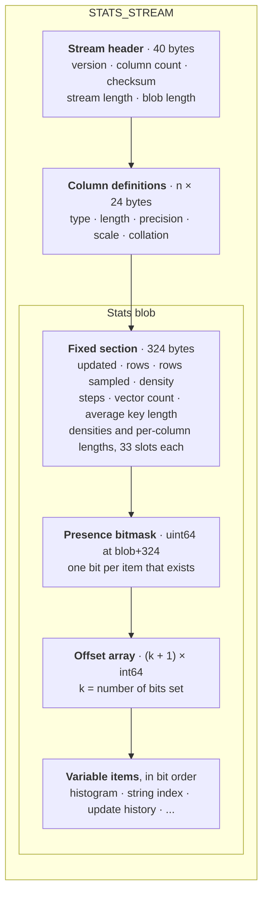
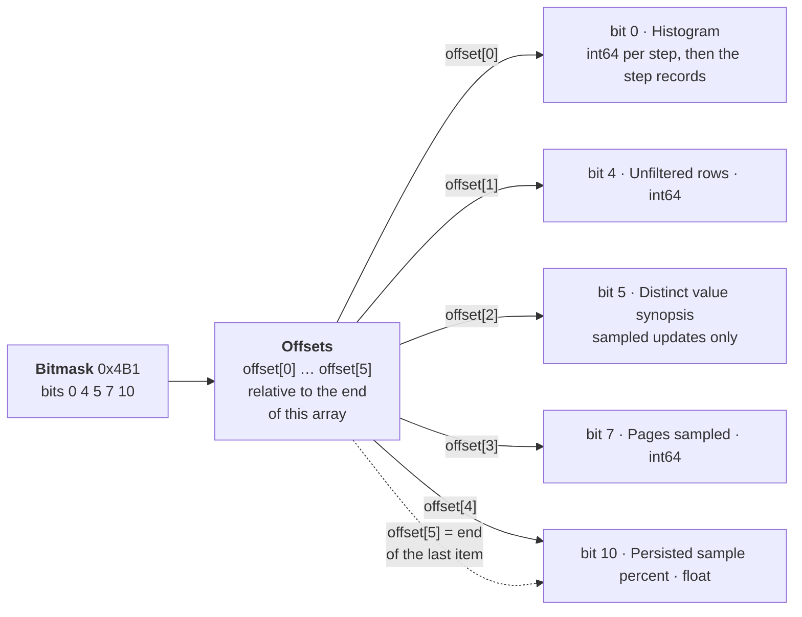
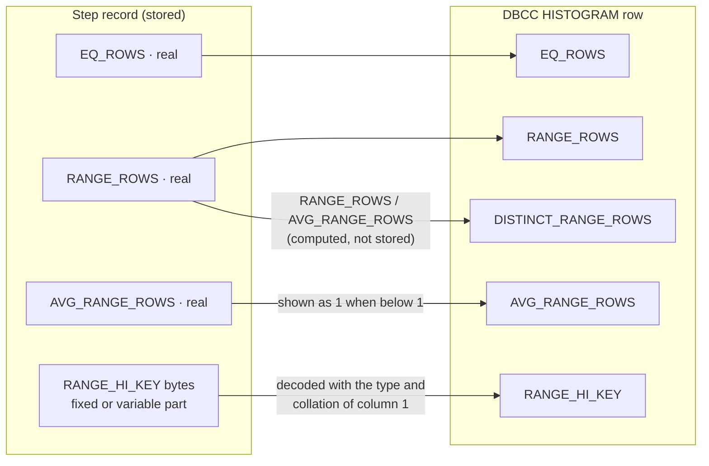
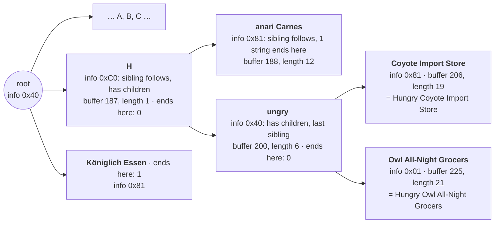

# STATS_STREAM binary layout (SQL Server 2025, 17.0.5015.4)

This is the layout used by `Decode-StatsStream.ps1` and its T-SQL port `usp_DecodeStatsStream.sql`. It was reverse engineered from `DBCC SHOW_STATISTICS ... WITH STATS_STREAM`, starting from the work of Joe Chang ([Decoding Stats Stream](https://qdpma.azurewebsites.net/CBO/StatStream.html)) and André Renato Furtado ([Understanding SQL Server STATS_STREAM: A Deep Dive](https://www.linkedin.com/pulse/understanding-sql-server-statsstream-deep-dive-andr%25C3%25A9-renato-furtado-63o3f/), and his StatsStreamParser). Every decoded value was checked against `DBCC SHOW_STATISTICS` (STAT_HEADER, DENSITY_VECTOR, HISTOGRAM) and the trace flag 2388 output on about 5,400 statistics. Those checks found no differences.

The layout was then checked against the SQL Server 2025 engine itself (CU10), disassembled with the help of its public symbols from the Microsoft symbol server. The function names quoted below (`CStatBlob::AddDensities`, `CTrieOnDisk::Flatten`, ...) are those public symbol names. Every variable-section item has a named reader and writer there. Items marked *(2025 binary)* were confirmed that way. This check found two decoder bugs, the trie node size (section 4.2) and the density slot of the last vector when there are more than 33 vectors (section 3), and explained the two items that were still unknown (bits 5 and 6).

All integers are little-endian. "real" means a 4-byte IEEE float and "float" an 8-byte one. Offsets marked *blob+* are relative to the start of the stats blob.

## Overview

A stream has three parts, one after the other: a 40-byte header, one 24-byte definition per statistics column, and the stats blob. The blob starts with a fixed 324-byte section. Everything else is in its variable section, where a presence bitmask says which items exist and an offset array says where each one starts.



Reading a stream follows the same order: check the header (lengths and checksum), read the column definitions to know how to decode the keys, read the fixed section, then use the bitmask and offsets to jump to each item. Sections 1 to 4 below describe each part.

## 1. Stream header (40 bytes)

| Offset | Size | Field |
|---|---|---|
| 0 | 4 | Stream version (1) |
| 4 | 4 | Number of stats columns (n) |
| 8 | 8 | Reserved (0) |
| 16 | 4 | Checksum (see below) |
| 20 | 4 | High half of the checksum field (0) |
| 24 | 8 | STATS_STREAM total length |
| 32 | 8 | Stats blob length |

**Checksum.** The stored uint32 is `~CRC32(stream)`, computed with bytes 16-19 set to 0. CRC32 here is the standard reflected CRC with polynomial 0xEDB88320, init 0xFFFFFFFF and final xor 0xFFFFFFFF. In practice, run the CRC loop without the final xor and the result equals the stored value. SQL Server only checks it when a stream is imported (`UPDATE STATISTICS ... WITH STATS_STREAM`). It is not stored in the database.

## 2. Column definitions (n × 24 bytes, starting at offset 40)

| Offset | Size | Field |
|---|---|---|
| 0 | 1 | system_type_id |
| 1 | 1 | Flags. Bit 0 = NOT NULL, bit 1 is always set, bit 3 is set for CLR types |
| 2 | 2 | Not initialized (garbage) |
| 4 | 4 | user_type_id |
| 8 | 2 | max_length (-1 = max) |
| 10 | 1 | precision |
| 11 | 1 | scale |
| 12 | 4 | 0. For hierarchyid it holds 20 |
| 16 | 4 | Collation ID, the same as `COLLATIONPROPERTY(name,'CollationId')`. Bit 0x80 = UTF-8. The high byte is the sort ID of SQL collations |
| 20 | 4 | Not initialized (garbage) |

Index statistics on a nonclustered index list the clustering key columns after the index keys.

## 3. Stats blob, fixed section (324 bytes)

| blob+ | Size | Field |
|---|---|---|
| 0 | 4 | Blob version (7 today; the 2025 code still reads the older versions 3 to 6) |
| 4 | 8 | Updated (`datetime`: int32 ticks of 1/300 s, then int32 days since 1900-01-01) |
| 12 | 8 | Rows |
| 20 | 8 | Rows sampled |
| 28 | 4 | Density, real, shown as STAT_HEADER Density |
| 32 | 132 | All density, real[33]. Slots 1-32 hold vectors 1-32. Slot 33 (blob+160) holds the **last** vector: vector 33 when there are 33 or fewer, otherwise vector n, with vectors 33 to n−1 in item bit 8 *(2025 binary: `CStatBlob::AddDensities`, `GetDensity`)* |
| 164 | 4 | Histogram steps, excluding the NULL step |
| 168 | 4 | Elements in the step offset array. Must equal the step count, or the import fails with state 17 *(2025 binary: `CStatHeaderPrev::Validate`)* |
| 172 | 4 | Vector count |
| 176 | 4 | Minimum histogram record length (fixed-data length of a step record) |
| 180 | 4 | Average key length, real. Must be close to the sum of the per-column averages, or the import fails with state 32 *(2025 binary: `CStatHeader::Validate`, `FCloseKeyLengths`)* |
| 184 | 4 | Rows again, as a real: RANGE_ROWS + EQ_ROWS of every step, NULL step included. The histogram is scaled to the table, so it equals Rows |
| 188 | 4 | NULL step EQ_ROWS, real (0 = no NULL step) |
| 192 | 132 | Average length **per column**, real[33] for columns 1-33. Columns 34 and up are in item bit 9 *(2025 binary: `CStatBlob::AddAvgKeyLengths`)*. DBCC's "Average Length" is the running sum of these |

An empty blob (length 0) means the statistics were never populated, for example when they were created on an empty table.

## 4. Stats blob, variable section

At blob+324 is a uint64 **presence bitmask**. It is followed by (k+1) int64 offsets, where k is the number of bits set. The offsets are relative to the end of the offset array. Items appear in bit order, and item *i* spans `offset[i] .. offset[i+1]` *(2025 binary: `CStatBlob::InitPointers`, `FGetStatsCategoryOffset`, `SetStatsCategoryAndOffsets`)*. Bit 2 is not used by the 2025 code.

For example, a statistic on an integer column of a 2,000,000-row table, created `WITH SAMPLE 5 PERCENT`, has bits 0, 4, 5, 7 and 10 set (bitmask 0x4B1), so k = 5. Six offsets follow the bitmask, and item *i* is the bytes between offset *i* and offset *i + 1*:



The item's position in the array comes from its rank among the set bits, not from the bit number: bit 10 is the 5th bit set, so it is item 4. A missing bit means the item is absent, and the following items move up. A string column adds bit 1 (string index), and a statistic updated more than once adds bit 3 (update history).

All bits below were confirmed in the 2025 binary (the mask each `CStatBlob` getter passes to `FGetStatsCategoryOffset`, and each writer passes to `SetStatsCategoryAndOffsets`).

| Bit | Item | Content |
|---|---|---|
| 0 | Histogram | Step offset array (int64 × steps), then the step records |
| 1 | String index | Trie (string summary) for char and n-char keys. Not built for UTF-8 collations |
| 3 | Update history | The previous 3 updates, as shown under trace flag 2388 (`AddCompHistories`: current + up to 2 older) |
| 4 | Unfiltered rows | int64 |
| 5 | Distinct value synopsis | Sampled updates only. See 4.5 |
| 6 | Columnstore page counts | Columnstore index statistics only. See 4.6 |
| 7 | Pages sampled | int64 (for example, 1050 of 2100 pages at 50%) |
| 8 | Densities, vectors 33 to n−1 | real[n − 33], present when there are more than 33 vectors. The last vector is in the fixed section's slot 33 |
| 9 | Average lengths, columns 34 to n | real[n − 33] |
| 10 | Persisted sample percent | float |
| 11 | Streaming statistics flags | uint32. Written by the streaming statistics code path (Fabric / Polaris, behind feature switches); not seen on a box instance |

Bit 2 and any other unknown bits are dumped as hex by the script.

### 4.1 Histogram step record (FixedVar row, 4 columns)

```
[status A][status B][fixed-data end: uint16]
EQ_ROWS real | RANGE_ROWS real | AVG_RANGE_ROWS real | RANGE_HI_KEY (fixed-length types)
[column count: uint16 = 4][NULL bitmap: 1 byte]
if status A & 0x20: [var column count: uint16][end offsets: uint16 each (0x8000 = complex)][RANGE_HI_KEY bytes]
```

`DISTINCT_RANGE_ROWS` is not stored. DBCC computes it as `RANGE_ROWS / AVG_RANGE_ROWS`. When the stored average is below 1, which can happen after sampling, DBCC shows AVG_RANGE_ROWS = 1 and DISTINCT_RANGE_ROWS = round(RANGE_ROWS).

How one step record becomes one row of `DBCC SHOW_STATISTICS ... WITH HISTOGRAM`:



The NULL step has no record. When blob+188 is not 0, DBCC adds a first row with RANGE_HI_KEY = NULL and that value as EQ_ROWS.

**Key storage formats:**

| Type | Format |
|---|---|
| int family | Little-endian integer |
| bit | 1 byte |
| decimal/numeric | Sign byte (1 = positive), then a little-endian magnitude scaled by 10^scale |
| money | int64 / 10000 |
| smallmoney | int32 / 10000 |
| date | 3 bytes: days since 0001-01-01 |
| time(p) | 3-5 bytes: units of 10^-p s |
| datetime2(p) | time, then date |
| datetimeoffset(p) | time, then date (UTC), then int16 offset in minutes |
| datetime | int32 ticks of 1/300 s, then int32 days |
| smalldatetime | uint16 minutes, then uint16 days |
| uniqueidentifier | .NET Guid byte order |
| char/varchar | Code page of the collation |
| nchar/nvarchar | UTF-16LE |
| sql_variant | Base type, version 1, then properties (decimal: precision + scale; time types: scale; binary: maxlen(2); strings: maxlen(2) + collation(4)), then the value |
| hierarchyid | Serialized OrdPath bytes |

### 4.2 String index (trie) *(2025 binary)*

Written by `COnDiskHistogram::Persist`, `CTrieOnDisk::Flatten` and `CTrieOnDiskNode::Flatten`: a collapsed, compressed trie over a sample of the strings, used to estimate LIKE predicates.

| Offset | Size | Field |
|---|---|---|
| 0 | 1 | 0xFF, trie present |
| 1 | 4 | Trie format version (1) |
| 5 | 4 | NULLs in the sample |
| 9 | 4 | Strings sampled, NULLs included |
| 13 | 4 | Distinct strings in the sample, NULL counting as one |
| 17 | 4 | Full prefix length, 40 |
| 21 | 4 | Full suffix length, 40. A string longer than 80 characters is stored as its first 40 and last 40 characters |
| 25 | 8 | Two unused int32 (0) |
| 33 | 4 | Character buffer length, in characters |
| 37 | | Character buffer (UTF-16 for n-types). Repeated substrings are stored once |
| | 4 | Node count, root included |
| | variable | Nodes, in pre-order |
| | 1 | Unused byte. `Persist` reserves `CTrieOnDisk::UlSpaceOnDiskInBytes()` + 1 bytes for the marker and the trie, then advances by that full size after the marker, so the item ends one byte past the data |

Each node is `[info: 1 byte][string: uint32][occurrences: 0, 1 or 4 bytes]`:

- info 0x80: a next sibling follows. 0x40: the node has children (they follow it).
- info & 0x0F: the occurrences, when 0-15. info 0x10: occurrences 16-255, in one more byte. info 0x20: occurrences above 255, in one more uint32.
- string: `offset << 8 | length` in characters, into the character buffer. Little-endian, so the bytes read as `[length][offset: 3 bytes]`.
- occurrences: sampled strings that end exactly at this node.

A real fragment, from the `ShipName` statistic of Northwind's `Orders` table. Node segments point into the character buffer, which stores the pieces back to back (`H`, `anari Carnes`, `ungry `, `Coyote Import Store`, `Owl All-Night Grocers` at characters 187 to 245):



On disk these nodes are written in pre-order (H, anari Carnes, ungry, Coyote Import Store, Owl All-Night Grocers, Königlich Essen), each one 5 bytes here because every count is below 16. A full string is the concatenation of the segments on its path, and the info byte's 0x80 / 0x40 bits are all a reader needs to rebuild the tree.

The occurrences add up to (strings sampled − NULLs). The nodes with occurrences, plus one when there are NULLs, equal the distinct count. Before the node encoder was checked, the decoders read every node as 5 bytes, which misread tries with a string repeated 16 or more times in the sample (3 of 446 tries in the lab).

### 4.3 Update history

The item starts with an int32 record count, followed by 76-byte records, newest first. The current update is not included.

| Record offset | Size | Field |
|---|---|---|
| 0 | 8 | Updated (`datetime`) |
| 8 | 8 | Table cardinality, float |
| 16 | 8 | Snapshot counter |
| 24 | 4 | Steps |
| 28 | 8 | Density, float |
| 36 | 8 | Rows above, float |
| 44 | 8 | Rows below, float |
| 52 | 8 | Inserts since last update, float |
| 60 | 8 | Deletes since last update, float |
| 68 | 8 | Squared variance error, float |

The values at +36 to +68 describe the update that came after this record. That matches the trace flag 2388 output, where each row takes its change columns from the history record below it. A column is branded Ascending when, in the 3 records, more than 90% of the inserted rows fall above the previous maximum (rows below for Descending).

### 4.4 Rebuilding the trace flag 2388 result

`DBCC SHOW_STATISTICS` under TF 2388 returns (history records + 1) rows:

| Row | Own columns (Updated … Density) | Change columns (Rows Above … Deletes) | Leading column Type |
|---|---|---|---|
| 1 | Blob header: Updated, Rows, *Snapshot Ctr*, Steps (without the NULL step), Density of vector 1 | History record 0 | Ascending / Descending / Stationary / Unknown |
| k + 2 | History record k | History record k + 1 | NULL |
| last | Oldest history record | NULL | NULL |

When the blob is empty, or has no vectors (columnstore index statistics), DBCC returns one row of NULLs.

**Snapshot Ctr of row 1 is not in the stream.** It is the leading column's modification counter at the time of the update. It is stored next to the blob, in `sys.sysobjvalues.value` (valclass 60, bigint), which can only be read over the DAC. `Decode-StatsStream.ps1 -UseDac` reads it from there. Without `-UseDac` the script shows the row count instead, which is only correct when the table was loaded by inserts alone. `sys.system_internals_partition_columns.modified_count` can't be used as a substitute, because it resets when the instance restarts.

### 4.5 Distinct value synopsis *(2025 binary)*

Read by `CStatBlob::GetSynopsis` into a `CDVEstimators` object, one `CDVEstimator` per vector. Earlier versions of this document called it the "sampled scan dump".

The item starts with one int64 offset per vector, relative to the variable section. Each vector then holds a uint32 count k followed by k floats (`CDVEstimator::Flatten` / `Expand`). The floats are hash values in (0, 1), stored in heap order, not sorted.

The estimator is a k-minimum-values sketch. `AddValue` keeps a max-heap of at most 1024 values and drops a value at or above the current top once the heap is full, so it holds the smallest hashes it has seen. When k is below 1024 it is the exact number of distinct values in the sampled rows. Otherwise (k − 1) / max estimates that number. For example, a 2,000,000-row table sampled at 387,310 rows gave 300 (exact), 49,920 (true 50,000) and 384,726 (true 387,310, all distinct). It counts distinct values **in the sample**, not in the table. `CDVEstimator::Union` merges two synopses, so they can be combined without rescanning.

This data is only present for sampled updates. The decoders show the count, min, max, the values and the "distinct in sample" figure.

### 4.6 Columnstore page counts *(2025 binary)*

On columnstore index statistics, bit 6 is the only bit set (`InitPointers` rejects bit 6 combined with any other bit, error state 37). Its offset pair records a length of 0, and the data follows the last offset:

| Offset | Size | Field |
|---|---|---|
| 0 | 4 | Column count N (`UlGetColumnStoreColumnCount`) |
| 4 | 8 × N | Page count per column, int64, in column_id order |

`CStatMan::FExtractCSPageCounts` requires the blob length to be exactly 352 + 8 × N (324 fixed + 8 mask + 16 offsets + 4 count). The statistics have no vectors and no histogram.

## 5. Writing a stream (`UPDATE STATISTICS ... WITH STATS_STREAM`)

`Decode-StatsStream.ps1` can also rebuild a stream from edited values (the app's **Edit statistics** mode, functions in the *encoder* region). These are the rules it follows. They were confirmed on SQL Server 2025 by importing edited streams for every key type and reading them back with `DBCC SHOW_STATISTICS`.

- **Checksum.** Recompute it after any change (section 1). A wrong checksum is rejected with "The provided statistics stream is corrupt."
- **Unchanged parts are copied byte for byte.** An unedited model reproduces the original stream exactly (1,098 of 1,098 lab statistics).
- **Fixed section.** Edits are patched in place: Updated, Rows, Rows sampled, Density, densities and per-column average lengths in the fixed arrays, average key length, and NULL step EQ_ROWS. Densities follow the slot rule of section 3 (with more than 33 vectors the last one goes to blob+160 and vectors 33 to n−1 to item bit 8); this was confirmed by importing edited densities for vectors 33, 35 and 40 of a 40-vector statistic. The steps count is written to both blob+164 and blob+168. The real copy of Rows at blob+184 follows Rows when it matched it.
- **Histogram item.** It is rebuilt: int64 offsets (relative to the item), then the records. A changed step takes its record layout from the original record or a neighbor. A key in the fixed part keeps its length (char, nchar and binary are padded). A key in the variable part gets a new end offset, and the record length can change. An empty variable key drops the variable section and clears status bit 0x20.
- **Shifting items.** When the histogram changes size, every later item moves. The offset array is recomputed, and the distinct value synopsis's per-vector offsets (relative to the variable section) shift by the same amount. Bytes after the last item are copied unchanged.
- **Lengths.** The stream length (offset 24) and blob length (offset 32) are rewritten.
- **The string index (trie) is not rebuilt.** After key edits it still describes the original keys, which only affects LIKE estimates. SQL Server accepts the stream anyway.
- **Import behavior.** The import keeps the stream's Updated date. It clears NORECOMPUTE unless `NORECOMPUTE` is part of the same statement. `ROWCOUNT` / `PAGECOUNT` cannot be combined with a column statistic ("is not a statistics collection").
- **Read-back differences.** After an import, `DBCC SHOW_STATISTICS ... WITH STATS_STREAM` returns the same stream, except the uninitialized bytes of the column definitions (offsets +2 and +20 of each, see section 2) and therefore the checksum.
- **Editable key types.** RANGE_HI_KEY can be edited for all types the decoder reads except sql_variant, hierarchyid and other CLR types. For those types the other step values can still be edited.
